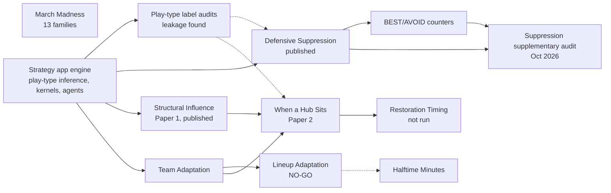

# Research history map

This map shows how the 319 study families are distributed across projects, topics and time, and how the projects connect. Counts come from `audit\summaries.md`, `audit\project_links.md` and `audit\family_crosstabs.md`.

**Caution on dates.** Most dates are file modification times (205 of 384 records) and may postdate the work. Month-level placement is approximate.

## 1. Projects

| project | families | dated span | main topics | verdicts (families) | publication state |
|---|---|---|---|---|---|
| Strategy app (`App\Strategy`) | 147 | 2026-04-13 to 2026-08-21 | engine and agent evaluation 70, suppression counters 26, labeling 12, sequences 10, adaptation 9 | null 43, descriptive 23, inconclusive 21, supported 16, artifact 15, failed gate 10, other 19 | not published |
| Defensive Suppression (with its supplementary audit) | 44 | 2026-05-25 to 2026-10-08 | suppression counters 35 | supported 11, null 11, descriptive 9, artifact 7, inconclusive 4, other 2 | published ("Detecting Defensive Suppression") |
| Structural Influence (Paper 1) | 41 | 2026-07-12 to 2026-11-02 | structural roles 32, absence 7 | null 16, supported 14, inconclusive 4, other 7 | published |
| When a Hub Sits (Paper 2) | 33 | 2026-07-12 to 2026-11-02 | absence and reorganization 32 | null 14, supported 7, failed gate 4, abandoned 3, other 5 | manuscript |
| Team Adaptation (including the lineup/team adaptation tests) | 23 | 2026-05-05 to 2026-11-02 | lineup and matchup 11, engine 5, adaptation 3 | null 10, inconclusive 4, artifact 3, other 6 | not published |
| Lineup Adaptation (measurement, shot adaptation, substitution response) | 14 | 2026-11-02 to 2026-11-09 | lineup and matchup 14 | null 7, failed gate 5, other 2 | not published; verdicts NO-GO |
| March Madness | 13 | 2026-03-08 to 2026-03-18 | NCAA prediction 13 | null 6, supported 6, descriptive 1 | not published |
| Halftime Minutes (including playing time and luck) | 3 | 2026-10-07 to 2026-10-21 | playing time and luck 3 | supported 2, artifact 1 | manuscript |
| Restoration Timing | 1 | 2026-11-09 | absence 1 | abandoned (specified, deliberately not run) | none |

Project labels come from the records. The Defensive Suppression and Team Adaptation rows combine sub-labels.

## 2. Timeline

**Families by topic and month (fact, approximate dates):**

| topic | Mar | Apr | May | Jun | Jul | Aug | Oct | Nov |
|---|---|---|---|---|---|---|---|---|
| NCAA tournament prediction | 13 | 1 | | | | | | |
| Strategy engine and AI agent evaluation | | 37 | 32 | 8 | 1 | | 1 | |
| Play-type labeling and data quality | | 6 | 4 | 4 | | | 2 | 2 |
| Defensive suppression and counter strategy | | 1 | 20 | 21 | 3 | 2 | 15 | |
| In-game and series adaptation | | | 9 | 1 | | | | 2 |
| Possession sequences and transitions | | | 1 | 8 | 1 | | | |
| Structural roles and influence | | | 2 | 6 | 16 | 15 | | 1 |
| Player absence and offensive reorganization | | | | | 13 | 3 | 1 | 25 |
| Playing time and luck response | | | | | | | 3 | |
| Lineup and matchup effects | | 4 | 1 | | | | 3 | 22 |

No family is dated September 2026. The table omits shot selection (1 family, April) and unclassified families (7, April to July).

**Interpretation.** The history runs in six overlapping phases:

1. **March 2026:** NCAA tournament modelling, a separate project with its own data.
2. **April to May 2026:** building and evaluating the strategy engine (play-type inference, matchup kernels, calibration, LLM agents). Play-type labels and their audits date from this phase.
3. **May to June 2026:** suppression triggers, BEST/AVOID counters, sequence memory and within-game adaptation, all on top of the engine's play-type labels.
4. **July to August 2026:** structural influence, fragility and portability (Paper 1), and the first absence validations.
5. **October 2026:** a supplementary audit of the published suppression result (TMP-001, TMP-012, CHT-063), the playing-time and luck studies, and the lineup/team adaptation battery.
6. **November 2026:** the When a Hub Sits analyses (absence, restoration, scouting), the Lineup Adaptation measurement, shot-adaptation and substitution-response studies (NO-GO), and the Restoration Timing specification (not run).

## 3. How the projects connect

Solid arrows show lineage recorded in the records' `related` fields or shared study families. Dotted arrows show shared inputs: the play-type labels feed every project that uses them, and the halftime-minutes work grew out of the adaptation question.

**Recorded cross-project links (fact, `audit\project_links.md`):**

| project pair | related-field references | shared study families |
|---|---|---|
| Structural Influence and When a Hub Sits | 12 | 8 |
| Defensive Suppression and Strategy app | 10 | 10 |
| Strategy app and Team Adaptation | 7 | 3 |
| Team Adaptation and When a Hub Sits | 3 | 0 |
| other pairs | 1 or 2 each | |

Related-field references have no verified direction, and one (Lineup Adaptation to March Madness) looks spurious.

## 4. Shared foundations and their failure points

**Fact.**
- **Shared data:** most projects share one data layer, the NBA play-by-play possessions and play-type initiation records in the Neo4j graph, with inferred play-type labels.
- **Label problems that propagate:**

| problem | record |
|---|---|
| Assisted-flag leak inflating SPOT_UP to 2.83 PPP | PAP-096 |
| Outcome-aware relabelling of 53.7% of possessions | TMP-007 |
| OTHER and DRIVE foul leakage | CHT-025 |
| A labeling switch in March to April 2025 | TMP-032 |
| A label backfill failing its distribution checks | APPA-030 |

**Interpretation.**
- **How far label errors reach:** they spread to every topic built on play-type shares or play-type PPP, which is most of the history.
- **Dependence on the fix date:** whether a downstream result was computed before or after a label fix determines whether it inherits the error. The records rarely state this.
- **What the benchmark needs:** a "data-version" field for each record, recorded during curation, so that an agent's reasoning about inherited artifacts can be scored.

## 5. Where each research program ended

| program | final recorded state | key records |
|---|---|---|
| Strategy engine as a decision aid | Engine variants mostly null against simple baselines. A linear team-plus-opponent-plus-play-type baseline matches the kernel (R 0.467 vs 0.466). Agent evaluations too small to score. | CHT-004 and PAP-097 (SF27), SF11, APPA-061, APPA-026 to APPA-028 |
| Defensive suppression | Published excess contested by a later within-unit permutation null | SF01, APPS-072, TMP-001, TMP-012 |
| BEST/AVOID counters | Gap replicated; its matchup specificity is null; reproduced by a fixed ranking | SF03, APPS-023, APPM-034, CHT-063 |
| Structural roles (Paper 1) | Structure persists and travels; presence effects on PPP are null | SF17 to SF19, PAP-010, PAP-011, SF28 |
| Absence reorganization (Paper 2) | Displacement detected and ranked by L_pre, largely mechanically; restoration unreliable; scouting forecasts null | SF21 to SF24, PAP-054, SF26 |
| Team and lineup adaptation | Behavior persistent; payoffs and traits undetectable; substitution timing follows the rotation clock | SF13, CHT-072, PAP-082, PAP-084, PAP-078 |
| Playing time and luck | Coaches' halftime minutes respond to opponent three-point luck, which has no persistent component | SF36, PAP-068 |
| NCAA prediction | Small Brier gains from features, calibration blends and post-processing | PAP-086 to PAP-095 |
